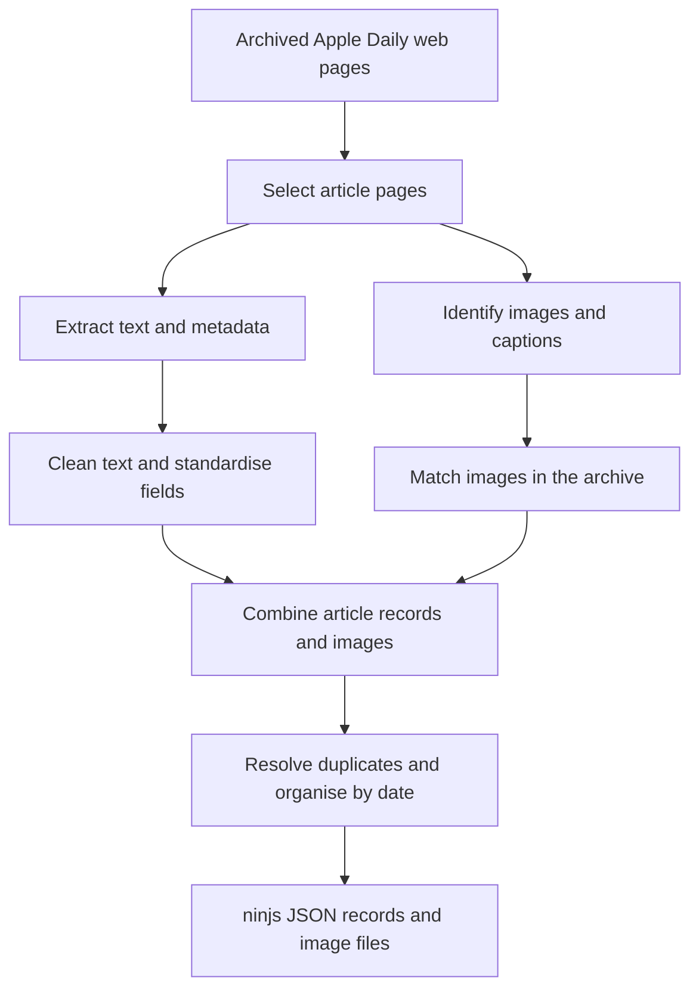

# Collection and processing

Parent: [Dataset documentation](README.md)

The dataset transforms archived Taiwan Apple Daily web pages into structured news records and associated images. It supports preservation and research access after the source website became unavailable. The source material was born digital; no scanning or OCR is involved.

## Processing overview

This overview describes the V3 pipeline. The diagram shows the main data transformations; implementation details and the applicable code version are linked at the end.

**The result is not a complete collection of all Taiwan Apple Daily news.** Missing captures, extraction errors, and cleaning rules affect which articles and images are available.

## Source and collection

| Item | Description |
| --- | --- |
| Original material | Taiwan Apple Daily news pages, images, and related web resources. |
| Archive provider | ArchiveBot / Archive Team. |
| Source archive | [ArchiveBot job `202209030158271bpf8`](https://archive.fart.website/archivebot/viewer/job/202209030158271bpf8). |
| Archive format | WARC files containing captured web responses. |
| Archive inventory | 804 numbered WARC shards, plus `meta.warc.gz`. |
| Approximate size | About 4.33 TB according to the existing archive description; exact bytes and unit convention have not been confirmed. |
| Capture period | The job identifier contains `2022-09-03 01:58:27`; its timezone and meaning require confirmation. The collection end is not verified. |
| Coverage | Incomplete. The original crawl seeds, scope, and exclusion rules have not been fully established. |

Journalists, editors, photographers, and other contributors produced the original content. Website systems supplied page metadata, and ArchiveBot captured web resources and archival metadata. The converter selects supported article pages from those archived responses.

## Preprocessing and cleaning

| What is processed? | What changes? | What should users know? |
| --- | --- | --- |
| Article URLs and IDs | Tracking parameters and fragments are removed; article IDs are extracted from supported URL paths. | Selection depends on recognised website and URL structures. |
| Article text | Text is extracted from page content, with alternative extraction sources when needed. | Some records may contain only a metadata description rather than the full article. |
| Promotional text | Known promotional or membership text is removed using rules. | Some advertising may remain, and legitimate text may be removed. |
| Characters and spacing | Likely encoding errors, HTML entities, unusual spaces, and selected control characters are cleaned. | These operations repair text artifacts; they do not guarantee error-free transcription. |
| Dates | Publication evidence is prioritised and accepted timestamps are normalised to Taiwan time. | A valid URL date may supply a fallback publication date. Capture time is distinct from publication time. |
| Bylines and locations | Rules parse the source credit line into separate fields. | Missing or ambiguous values remain empty; parsing errors are possible. |
| Images and captions | Page evidence identifies candidate images, which are matched to archived image responses. | Matching is limited to the same WARC shard. Missing captures and incorrect associations remain possible. |
| Duplicate articles | Repeated article responses are merged within a shard; competing records at the same date-and-ID output location are resolved. | The same ID under different dates can remain in the dataset. |

The pipeline does not anonymise, translate, tokenise, stem, or semantically balance the article content.

## Output and validation

The output contains ninjs 3.2 JSON records and available images. Metadata is derived automatically, not supplied as human-verified gold annotations. Targeted developer checks do not constitute full-dataset validation; there is no human annotation workforce or crowdsourcing process.

See [Composition and fields](composition.md) for the directory layout, date fallbacks, field meanings, and statistics. See [Distribution and licensing](distribution.md) for content rights; documenting the processing chain does not establish ownership of the source articles or images.

## Version and technical references

This description applies to **V3**, tag **`dataset-v3`**, commit [`4acdaa18db98c701ba90ce3a2a9beb191f0a7f40`](https://github.com/jimmy93029/appledaily_warc_file_scrawler/tree/4acdaa18db98c701ba90ce3a2a9beb191f0a7f40). A dataset release should separately record the code version actually used to produce it.

- [Pipeline documentation and software requirements](../downloads/README.md)
- [ninjs format and field differences](../downloads/NINJS_FORMAT_DIFF.md)
- [Tests and diagnostic tools](../smoke-test/README.md)
- [Extraction and image matching](../downloads/extract_warc2.py)
- [Text cleaning and date rules](../downloads/final_cleaning_rules.py)
- [Output organisation and duplicate selection](../downloads/organize_deduplicate.py)

The download pipeline does not yet provide a complete pinned dependency lock file.
